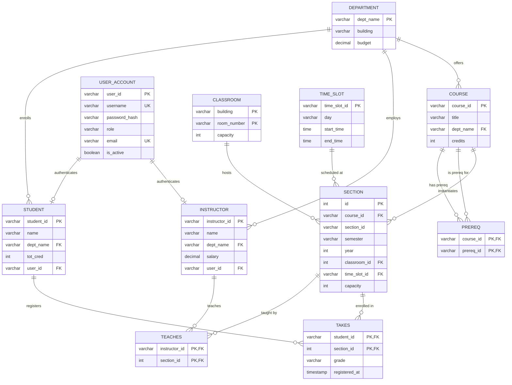

# University Course Registration & Management System
> **DBS (Database Systems) Lab Mini Project**  
> Strict Three-Tier Architecture: Presentation (Browser) &rarr; Application (Business Logic) &rarr; Data (Relational DB in 3NF)

---

## 1. System Architecture

The system strictly follows a clean **Three-Tier Architecture**:

```
+-----------------------------------------------------------------------+
|                       1. PRESENTATION TIER                            |
|  - HTML5, CSS3, Modern Vanilla JavaScript (No heavy frameworks)      |
|  - Client-side AJAX/Fetch dynamic rendering & DOM updates             |
|  - Real-time seat counters, timetable grids, grade entry, toast alerts |
|  - Light / Dark theme toggle with localStorage persistence            |
+-----------------------------------------------------------------------+
                                   ▲
                                   │ JSON API / HTTP REST
                                   ▼
+-----------------------------------------------------------------------+
|                       2. APPLICATION TIER                             |
|  - Primary: Python 3.11 with Django 5.2 (REST JSON + Views)           |
|  - Alternate: Java Servlets + JSP (Maven, Tomcat, JDBC) in /java-ver  |
|  - Role-Based Access Control (RBAC): Student, Instructor, Admin       |
|  - ACID Transactional Business Rules Engine (Row Locks, Rollbacks)    |
|  - Connection Pooling (Django CONN_MAX_AGE / HikariCP for Java)       |
+-----------------------------------------------------------------------+
                                   ▲
                                   │ Parameterized SQL / ORM
                                   ▼
+-----------------------------------------------------------------------+
|                          3. DATA TIER                                 |
|  - Strict 3NF Relational Database Schema                              |
|  - PostgreSQL (Primary) / MySQL / SQLite (Immediate Out-of-the-Box)   |
|  - Referential integrity: ON DELETE / ON UPDATE CASCADE / RESTRICT    |
|  - CHECK constraints (credits > 0, capacity > 0, budget >= 0)         |
|  - Optimized Composite Indexes & Stored Views                         |
+-----------------------------------------------------------------------+
```

---

## 2. Entity-Relationship (ER) Diagram (Mermaid)



---

## 3. Relational Schema in Third Normal Form (3NF)

1. **`department`** (`dept_name`, `building`, `budget`)
   - Primary Key: `dept_name`
   - Constraints: `budget >= 0`

2. **`user_account`** (`user_id`, `username`, `password_hash`, `role`, `email`, `is_active`, `created_at`)
   - Primary Key: `user_id`
   - Unique Keys: `username`, `email`
   - Constraints: `role IN ('student', 'instructor', 'admin')`

3. **`student`** (`student_id`, `name`, `dept_name`, `tot_cred`, `user_id`)
   - Primary Key: `student_id`
   - Foreign Keys: `dept_name` &rarr; `department(dept_name)`, `user_id` &rarr; `user_account(user_id)`
   - Constraints: `tot_cred >= 0`

4. **`instructor`** (`instructor_id`, `name`, `dept_name`, `salary`, `user_id`)
   - Primary Key: `instructor_id`
   - Foreign Keys: `dept_name` &rarr; `department(dept_name)`, `user_id` &rarr; `user_account(user_id)`
   - Constraints: `salary >= 0`

5. **`classroom`** (`building`, `room_number`, `capacity`)
   - Primary Key: `(building, room_number)`
   - Constraints: `capacity > 0`

6. **`course`** (`course_id`, `title`, `dept_name`, `credits`)
   - Primary Key: `course_id`
   - Foreign Key: `dept_name` &rarr; `department(dept_name)`
   - Constraints: `credits > 0 AND credits <= 10`

7. **`prereq`** (`course_id`, `prereq_id`)
   - Primary Key: `(course_id, prereq_id)`
   - Foreign Keys: `course_id` &rarr; `course(course_id)`, `prereq_id` &rarr; `course(course_id)`
   - Constraints: `course_id <> prereq_id`

8. **`time_slot`** (`time_slot_id`, `day`, `start_time`, `end_time`)
   - Primary Key: `time_slot_id`
   - Constraints: `day IN ('Monday'..'Sunday')`, `start_time < end_time`

9. **`section`** (`course_id`, `section_id`, `semester`, `year`, `building`, `room_number`, `time_slot_id`, `capacity`)
   - Unique Key: `(course_id, section_id, semester, year)`
   - Foreign Keys: `course_id` &rarr; `course`, `(building, room_number)` &rarr; `classroom`, `time_slot_id` &rarr; `time_slot`
   - Constraints: `capacity > 0`, `year BETWEEN 2000 AND 2100`

10. **`teaches`** (`instructor_id`, `section_id`)
    - Primary Key: `(instructor_id, section_id)`
    - Foreign Keys: `instructor_id` &rarr; `instructor`, `section_id` &rarr; `section`

11. **`takes`** (`student_id`, `section_id`, `grade`, `registered_at`)
    - Primary Key: `(student_id, section_id)`
    - Foreign Keys: `student_id` &rarr; `student`, `section_id` &rarr; `section`
    - Constraints: Valid grades or `IP` (In Progress)

---

## 4. Business Rules Enforced (ACID Transactions)

Every course registration runs inside `transaction.atomic()` with **row-level locking** (`SELECT ... FOR UPDATE`):
1. **No Duplicate Registration**: A student cannot register for the same course in the same semester.
2. **Prerequisite Completion**: If course $C$ requires prerequisite $P$, the student must have completed $P$ in a prior term with a passing grade (`A+` down to `D`, or `P`).
3. **Credit Limit per Semester**: Total registered credits in the semester cannot exceed **18 credits**.
4. **Time-Slot Clash Prevention**: Student cannot register for two sections on the same day with overlapping time windows (`start_1 < end_2 AND end_1 > start_2`).
5. **Capacity Limit**: Section registration is blocked when current enrollment equals or exceeds section capacity.
6. **Classroom & Instructor Double-Booking Prevention**: Admin scheduling rejects section creation if room or instructor is already assigned at the same time slot.

---

## 5. Sample User Accounts for Each Role

| Role | Username | Password | Full Name / Description |
| :--- | :--- | :--- | :--- |
| **Admin** | `admin` | `admin123` | System Administrator (Full CRUD) |
| **Instructor** | `inst_cs101` | `teach123` | Dr. Alan Turing (Computer Science) |
| **Instructor** | `inst_cs102` | `teach123` | Dr. Grace Hopper (Computer Science) |
| **Instructor** | `inst_ee101` | `teach123` | Dr. Nikola Tesla (Electrical Eng) |
| **Student** | `stud_cs01` | `pass123` | Alice Johnson (CSE - Has passed CS101, MA101) |
| **Student** | `stud_cs02` | `pass123` | Bob Smith (CSE - Has passed CS101) |
| **Student** | `stud_cs03` | `pass123` | Charlie Brown (CSE - New student) |
| **Student** | `stud_ee01` | `pass123` | Ivy Chen (Electrical Eng) |

*(Quick 1-Click Login chips are also available directly on the login page!)*

---

## 6. Setup & Running Instructions

### Prerequisites
- Python 3.10+ (Installed)
- Java 17+ & Maven (For the optional `/java-version` backend)

### Step 1: Install Python Dependencies
```bash
cd university_course_system
pip install -r requirements.txt
```

### Step 2: Database Configuration (`.env`)
By default, `DB_ENGINE=sqlite` is active in `.env`, allowing you to run the complete system immediately without external database servers.

To switch to **PostgreSQL**:
```env
DB_ENGINE=postgresql
DB_NAME=university_db
DB_USER=postgres
DB_PASSWORD=your_password
DB_HOST=localhost
DB_PORT=5432
```
And execute the PostgreSQL schema: `psql -U postgres -d university_db -f database/schema_postgres.sql`

To switch to **MySQL**:
```env
DB_ENGINE=mysql
DB_NAME=university_db
DB_USER=root
DB_PASSWORD=your_password
DB_HOST=localhost
DB_PORT=3306
```

### Step 3: Run Migrations and Seed Data
```bash
python manage.py migrate
python manage.py seed_db
python manage.py apply_views
```

### Step 4: Run Automated Tests
```bash
python manage.py test apps.tests.test_business_rules
```
*(All 9 business rule tests run against prerequisite, time clash, capacity, and credit limit validations).*

### Step 5: Start Development Server
```bash
python manage.py runserver 8000
```
Open **`http://localhost:8000/`** in your browser.

---

## 7. Alternate Java Backend (`/java-version`)

Located in `java-version/`, this backend implements identical features:
- **Maven & Jakarta Servlets 6.0**: `AuthServlet`, `CourseServlet`, `RegistrationServlet`, `InstructorServlet`
- **HikariCP**: High-performance connection pooling
- **PreparedStatement**: Parameterized queries preventing SQL injection
- **Running**:
  ```bash
  cd java-version
  mvn clean package
  # Deploy target/university-course-system.war to Apache Tomcat 10+
  ```

---

## 8. DBS Lab Demonstration Queries (10 Advanced SQL Queries)

See full file at `database/sample_queries.sql`.

### Query 1: Multi-Table INNER JOIN (Weekly Student Timetable)
```sql
SELECT 
    s.student_id, s.name AS student_name, c.course_id, c.title,
    sec.section_id, ts.day, ts.start_time, ts.end_time,
    sec.building, sec.room_number, COALESCE(i.name, 'TBA') AS instructor
FROM takes t
JOIN student s ON t.student_id = s.student_id
JOIN course c ON t.course_id = c.course_id
JOIN section sec ON t.course_id = sec.course_id AND t.section_id = sec.section_id 
    AND t.semester = sec.semester AND t.year = sec.year
JOIN time_slot ts ON sec.time_slot_id = ts.time_slot_id
LEFT JOIN teaches tch ON sec.course_id = tch.course_id AND sec.section_id = tch.section_id 
    AND sec.semester = tch.semester AND sec.year = tch.year
LEFT JOIN instructor i ON tch.instructor_id = i.instructor_id
WHERE t.student_id = 'S1001' AND t.semester = 'Fall' AND t.year = 2026
ORDER BY ts.day, ts.start_time;
```

### Query 2: GROUP BY with HAVING (Faculty Salary Breakdown)
```sql
SELECT dept_name, COUNT(instructor_id) AS faculty_count, ROUND(AVG(salary), 2) AS avg_salary, MAX(salary) AS max_salary
FROM instructor
GROUP BY dept_name
HAVING AVG(salary) >= 90000.00
ORDER BY avg_salary DESC;
```

### Query 3: LEFT OUTER JOIN (Course Offering Analysis)
```sql
SELECT c.course_id, c.title, c.dept_name, COUNT(s.section_id) AS sections_offered
FROM course c
LEFT JOIN section s ON c.course_id = s.course_id AND s.semester = 'Fall' AND s.year = 2026
GROUP BY c.course_id, c.title, c.dept_name
ORDER BY sections_offered DESC;
```

### Query 4: Subquery in WHERE (Prerequisite Eligibility Audit)
```sql
SELECT student_id, name, dept_name, tot_cred
FROM student
WHERE student_id NOT IN (
    SELECT student_id FROM takes 
    WHERE course_id = 'CS101' AND grade IN ('A+', 'A', 'A-', 'B+', 'B', 'B-', 'C+', 'C', 'D', 'P')
);
```

### Query 5: Correlated Subquery with EXISTS (Faculty Teaching Multi-Sections)
```sql
SELECT i.instructor_id, i.name, i.dept_name
FROM instructor i
WHERE (
    SELECT COUNT(*) FROM teaches t 
    WHERE t.instructor_id = i.instructor_id AND t.semester = 'Fall' AND t.year = 2026
) >= 2;
```

### Query 6: Derived Table (Capacity Utilization Percentage)
```sql
SELECT util.course_id, util.title, util.section_id, util.capacity, util.enrolled,
       ROUND((util.enrolled * 100.0 / util.capacity), 1) AS occupancy_pct
FROM (
    SELECT sec.course_id, c.title, sec.section_id, sec.capacity, COUNT(t.student_id) AS enrolled
    FROM section sec
    JOIN course c ON sec.course_id = c.course_id
    LEFT JOIN takes t ON sec.course_id = t.course_id AND sec.section_id = t.section_id 
        AND sec.semester = t.semester AND sec.year = t.year
    WHERE sec.semester = 'Fall' AND sec.year = 2026
    GROUP BY sec.course_id, c.title, sec.section_id, sec.capacity
) AS util
ORDER BY occupancy_pct DESC;
```

### Query 7: Set Operation (INTERSECT - Year-over-Year Courses)
```sql
SELECT course_id FROM section WHERE semester = 'Spring' AND year = 2026
INTERSECT
SELECT course_id FROM section WHERE semester = 'Fall' AND year = 2026;
```

### Query 8: Conditional Aggregation (CASE Statements for Standing)
```sql
SELECT dept_name, COUNT(student_id) AS total_students,
       SUM(CASE WHEN tot_cred < 20 THEN 1 ELSE 0 END) AS freshman_count,
       SUM(CASE WHEN tot_cred >= 20 AND tot_cred < 40 THEN 1 ELSE 0 END) AS sophomore_count,
       SUM(CASE WHEN tot_cred >= 40 AND tot_cred < 60 THEN 1 ELSE 0 END) AS junior_count,
       SUM(CASE WHEN tot_cred >= 60 THEN 1 ELSE 0 END) AS senior_count
FROM student
GROUP BY dept_name;
```

### Query 9: Self-Join for Conflict Auditing (Classroom Collisions)
```sql
SELECT s1.building, s1.room_number, s1.course_id AS course_1, s2.course_id AS course_2, ts1.day, ts1.start_time, ts1.end_time
FROM section s1
JOIN section s2 ON s1.building = s2.building AND s1.room_number = s2.room_number 
    AND s1.semester = s2.semester AND s1.year = s2.year 
    AND (s1.course_id <> s2.course_id OR s1.section_id <> s2.section_id)
JOIN time_slot ts1 ON s1.time_slot_id = ts1.time_slot_id
JOIN time_slot ts2 ON s2.time_slot_id = ts2.time_slot_id
WHERE s1.semester = 'Fall' AND s1.year = 2026 
  AND ts1.day = ts2.day 
  AND ts1.start_time < ts2.end_time AND ts1.end_time > ts2.start_time;
```

### Query 10: Window Function (DENSE_RANK within Department)
```sql
SELECT student_id, name, dept_name, tot_cred,
       DENSE_RANK() OVER (PARTITION BY dept_name ORDER BY tot_cred DESC) AS dept_rank
FROM student
ORDER BY dept_name, dept_rank;
```

